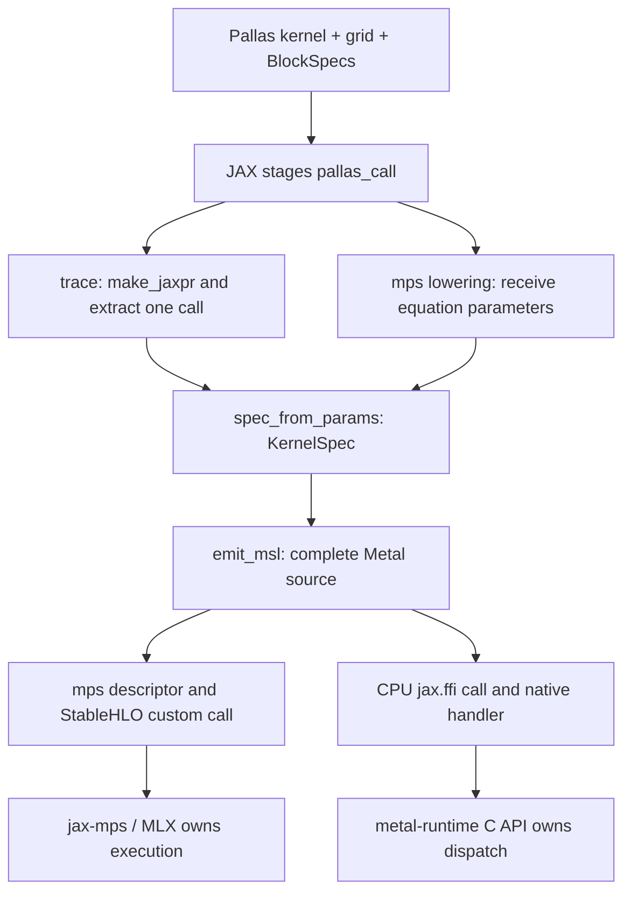

# Architecture and interview walkthrough

Palladium is a compiler and dispatch bridge for running a supported subset of
JAX Pallas kernels on Apple GPUs. It reuses JAX's tracing and Pallas's grid,
block, and Ref abstractions, translates the resulting kernel jaxpr into Metal
Shading Language (MSL), and connects that source to either jax-mps or a CPU
FFI handler.

The useful starting point for an interview is the shared compiler pipeline:
**Pallas kernel → kernel jaxpr and layouts → `KernelSpec` → MSL → dispatch.**
The dispatch integration and the mapping of a Pallas program onto GPU threads
are separate decisions.

## Repository map

| Building block | Responsibility | Start reading |
|---|---|---|
| Public API | Entry points, options, diagnostics, errors, and explicit gradients | [`__init__.py`](../src/palladium/__init__.py), [API guide](api.md) |
| Tracing adapter | Extract the kernel body and normalize Pallas metadata; reject unsupported structure and obvious write hazards | [`trace.py`](../src/palladium/trace.py), [`effects.py`](../src/palladium/effects.py) |
| MSL compiler | Assemble a kernel, lower primitives, or recognize a cooperative TensorOps pattern | [`emit/kernel.py`](../src/palladium/emit/kernel.py), [emitter guide](emitter.md) |
| Launch planning | Resolve compiler options, device thread limits, and program-to-thread geometry | [`launch.py`](../src/palladium/launch.py), [`device.py`](../src/palladium/device.py) |
| Pallas backend for MPS | Lower an ordinary Pallas call to a StableHLO custom call understood by jax-mps | [`mps.py`](../src/palladium/mps.py) |
| CPU-to-Metal FFI | Specialize calls and batch dispatches through JAX's CPU execution | [`ffi.py`](../src/palladium/ffi.py), [`palladium_ffi.cpp`](../native/ffi/palladium_ffi.cpp) |
| Diagnostics | Report launch geometry, emitted source size, and declared storage | [`diagnostics.py`](../src/palladium/diagnostics.py) |
| Explicit differentiation | Pair forward and backward callables using `jax.custom_vjp` | [`vjp.py`](../src/palladium/vjp.py) |
| Workloads and evidence | Runnable applications, benchmarks, correctness comparisons, source checks, and fuzzing | [`examples/`](../examples), [`benchmarks/`](../benchmarks), [`tests/`](../tests) |

The [`notes/`](../notes) directory contains design discussions and plans.
For current behavior, use the implementation and the [supported subset](supported-jax.md).

## How the JAX Pallas integration works

A Pallas kernel receives mutable Refs. `pl.pallas_call` supplies the full-array
shapes, program grid, and `BlockSpec` maps describing the tile visible to each
program. JAX stages the kernel as a stateful jaxpr whose equations include Ref
reads and writes, arithmetic, and nested control-flow regions.

Palladium consumes this representation rather than parsing Python. For
example, a static `lax.fori_loop` can arrive as a `scan`, and a `jnp.where`
can arrive inside a JIT-wrapped sub-jaxpr. These staging details explain both
the recursive emitter and the JAX 0.11 dependency boundary.

`KernelSpec` is the common boundary. It contains the kernel jaxpr, static
grid, input/output `BlockInfo` records, scratch descriptions, and validated
alias pairs. `BlockInfo` retains both the kernel-visible shape and the full
layout with squeezed axes, so the emitter can reconstruct physical offsets.
The record contains neither compiled GPU handles nor live input buffers.

Before emission, the adapter rejects foreign effects such as debug printing,
scalar-prefetch grids, and unsupported block-dimension kinds. Alias pairs must
have matching layouts, with all input reads preceding writes to the shared
output. Parallel-write validation rejects axes ignored by both the output map
and write indices. It does **not** prove that every accepted map is injective.

## Execution path 1: plain Pallas on MPS

Importing `palladium` installs a wrapper around JAX's common `pallas_call`
lowering rule. Noninterpreted calls on `mps` take Palladium's lowering;
other platforms and `interpret=True` delegate to JAX's original rule.
This registration uses JAX internals because `mps` is an external platform.

The lowering receives the already staged equation parameters, constructs a
`KernelSpec`, emits MSL, and builds `MpsDispatchDescriptor`. This versioned JSON
descriptor splits the source into header, parameter-binding prologue, and
body, and includes the resolved launch dimensions. Buffer shapes and layouts
are expressed by the custom call's IR types.

The emitted StableHLO target is **`palladium.dispatch`**. A matching jax-mps
handler rebuilds an MLX custom kernel, owns its buffers, and schedules it on
its Metal stream. This path does not call the native CPU FFI library in this
repository. The descriptor contains source and metadata rather than
process-local pipeline handles, which makes it suitable for the compiled IR.

Current limits: this integration requires the custom jax-mps handler, accepts
FAST math only, and rejects input/output aliases because its MLX path allocates
functional outputs. See [installation](../INSTALLATION.md) for the matching build.

## Execution path 2: CPU JAX with Metal dispatch

`palladium.metal_call(kernel, ...)` returns `FfiCallable`. The surrounding JAX
program runs on the CPU backend, while the custom call dispatches the kernel
to Metal. This allows `jax.jit` composition without a PJRT plugin.

On specialization, the callable validates input dtypes, traces its staged
Pallas call using shape/dtype examples, emits source, and computes a source
digest. A locked per-callable LRU retains up to 256 shape/dtype signatures.
The generated `jax.ffi.ffi_call` names the CPU target
**`palladium_dispatch`** and embeds source, launch geometry, math mode, and
batch strides as static attributes.

The C++ handler uses metal-runtime's C API to:

1. Reuse or compile a library and pipeline, keyed by source digest, entry
   point, and math mode in a separate native LRU.
2. Wrap XLA input and result buffers for Metal access.
3. Encode dispatches, commit the command buffer, and wait for completion.
4. Flush outputs when the buffer-wrapping path requires it and release wrappers.

One `vmap` level places per-element dispatches in a single native batch;
unbatched operands have byte stride zero. Enclosing batch levels use sequential
FFI batching. A batch still contains multiple GPU dispatches, so expressing
independent work in the Pallas grid can avoid that overhead.

`call.interpret` is the same kernel executed through Pallas's interpreter.
`call.explain` traces and emits without Metal compilation, and `debug_msl`
exposes source directly. Neither is a substitute for device execution when
validating compiler behavior or resource limits.

## Two GPU execution models

| Model | One Pallas program becomes | Typical use | Main resource pressure |
|---|---|---|---|
| Primitive emitter | One Metal thread | Small independent simulations, elementwise work, serial loops and reductions | Per-thread blocks, scratch, and intermediate storage |
| Cooperative TensorOps | One threadgroup of four SIMD groups | Recognized tiled matmul and online-softmax attention | Shared memory, register-held cooperative results, synchronization |

`CompilerParams(dot_general="auto")` attempts cooperative recognition for
kernels containing dots on a 2D or 3D grid and falls back when recognition
fails. `"default"` forces primitive emission; `"tensorops"` propagates a
recognition failure for a kernel containing dots. `"simdgroup"` behaves like
`"tensorops"`, but lowers supported float32 matmuls with `simdgroup_matrix`
fragments staged through threadgroup memory instead of `matmul2d`
(`emit/tensorops/simdgroup.py`). A kernel without dots still
uses primitive emission. Launch geometry follows the actual emitted source
after fallback.

## Differentiation and correctness

JAX can differentiate supported scalar calculations **inside** a kernel before
emission; those derivative equations are ordinary emitter inputs. Differentiating
the dispatched kernel as a whole requires an explicit backward implementation.
`with_vjp` attaches that implementation with `jax.custom_vjp` and can retain
trailing forward outputs as hidden residuals. Palladium does not derive a
backward kernel from emitted MSL.

The tests provide several kinds of evidence:

| Tests | Evidence |
|---|---|
| `tracing/` | Metadata normalization, effect rejection, aliasing and write-safety contracts |
| `codegen/` | Source structure, deterministic golden MSL, numeric boundaries, cooperative recognition, and device comparisons |
| `memory/`, `control_flow/` | Ref snapshots, edge guards, strided layouts, scratch, carry updates, and scan streaming |
| `runtime/` | FFI/JIT/vmap composition, MPS descriptors and lowering, dtype transport, and cache concurrency |
| `workloads/` | Independent numerical references, conservation properties, and explicit gradient checks |
| Opt-in fuzz tests | Generated expression and control-flow kernels compared with the interpreter |

## Suggested presentation sequence

1. **Problem and contract:** write a Pallas kernel once and lower a supported
   subset to Metal; explain program grids, tiles, and Refs with SAXPY.
2. **Integration:** show `KernelSpec`, then contrast the MPS custom-call
   descriptor with the CPU FFI handler and their buffer ownership.
3. **Compiler:** walk through [the emitter](emitter.md), including safe views,
   control-flow carries, and the cooperative TensorOps branch.
4. **Engineering tradeoffs:** discuss JAX internal API coupling, static shape
   specialization, conservative alias/write checks, and per-thread storage.
5. **Evidence:** show one source snapshot, one numerical comparison, and a
   workload such as RK4 ensembles or attention. Distinguish device results
   from source-only tests and report the actual math mode and timing conditions.
